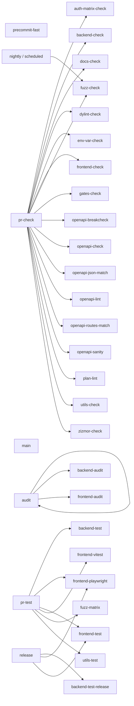

# Quality gates

Generated by `scripts/quality-gates.mjs` from the `justfile` and workflow files. Do not edit by hand.

## Lane graph

## Checks

### `audit`

Annotation: Run security audits (backend + frontend)

- Recipe: [justfile:473-473](https://github.com/codesam88/picasu/blob/main/justfile#L473-L473) `justfile:473-473`
- Lanes: audit
- Invocations:
  - [.github/workflows/audit.yml:48-48](https://github.com/codesam88/picasu/blob/main/.github/workflows/audit.yml#L48-L48) `.github/workflows/audit.yml:48-48`

### `auth-matrix-check`

Annotation: ensure auth-matrix artifacts match generator

- Recipe: [justfile:260-280](https://github.com/codesam88/picasu/blob/main/justfile#L260-L280) `justfile:260-280`
- Lanes: pr-check
- Invocations: (none direct; reached via aggregate)
- Underlying:
  - [backend/auth-matrix.json:1-2152](https://github.com/codesam88/picasu/blob/main/backend/auth-matrix.json#L1-L2152) `backend/auth-matrix.json:1-2152`
  - [docs/auth-matrix.md:1-139](https://github.com/codesam88/picasu/blob/main/docs/auth-matrix.md#L1-L139) `docs/auth-matrix.md:1-139`
  - [scripts/auth-matrix.mjs:1-249](https://github.com/codesam88/picasu/blob/main/scripts/auth-matrix.mjs#L1-L249) `scripts/auth-matrix.mjs:1-249`

### `backend-audit`

Annotation: cargo deny

- Recipe: [justfile:40-41](https://github.com/codesam88/picasu/blob/main/justfile#L40-L41) `justfile:40-41`
- Lanes: audit
- Invocations: (none direct; reached via aggregate)

### `backend-check`

Annotation: cargo fmt --check + clippy (all targets)

- Recipe: [justfile:19-21](https://github.com/codesam88/picasu/blob/main/justfile#L19-L21) `justfile:19-21`
- Lanes: pr-check
- Invocations:
  - [.github/workflows/ci.yml:131-136](https://github.com/codesam88/picasu/blob/main/.github/workflows/ci.yml#L131-L136) `.github/workflows/ci.yml:131-136`

### `backend-test`

Annotation: Backend tests (cargo-nextest)

- Recipe: [justfile:30-31](https://github.com/codesam88/picasu/blob/main/justfile#L30-L31) `justfile:30-31`
- Lanes: pr-test
- Invocations:
  - [.github/workflows/ci.yml:139-141](https://github.com/codesam88/picasu/blob/main/.github/workflows/ci.yml#L139-L141) `.github/workflows/ci.yml:139-141`

### `backend-test-release`

Annotation: Backend tests in release mode

- Recipe: [justfile:35-36](https://github.com/codesam88/picasu/blob/main/justfile#L35-L36) `justfile:35-36`
- Lanes: release
- Invocations:
  - [.github/workflows/release.yml:126-128](https://github.com/codesam88/picasu/blob/main/.github/workflows/release.yml#L126-L128) `.github/workflows/release.yml:126-128`

### `docs-check`

Annotation: check markdown (docs, .plan, utils)

- Recipe: [justfile:347-348](https://github.com/codesam88/picasu/blob/main/justfile#L347-L348) `justfile:347-348`
- Lanes: pr-check
- Invocations:
  - [.github/workflows/ci.yml:236-239](https://github.com/codesam88/picasu/blob/main/.github/workflows/ci.yml#L236-L239) `.github/workflows/ci.yml:236-239`
  - [.github/workflows/docs-check.yml:34-34](https://github.com/codesam88/picasu/blob/main/.github/workflows/docs-check.yml#L34-L34) `.github/workflows/docs-check.yml:34-34`

### `dylint-check`

Annotation: run dylint auth lints (advisory)

- Recipe: [justfile:151-152](https://github.com/codesam88/picasu/blob/main/justfile#L151-L152) `justfile:151-152`
- Lanes: pr-check
- Invocations:
  - [.github/workflows/ci.yml:282-282](https://github.com/codesam88/picasu/blob/main/.github/workflows/ci.yml#L282-L282) `.github/workflows/ci.yml:282-282`

### `env-var-check`

Annotation: check PICASU_* env vars match docs/config.md

- Recipe: [justfile:254-256](https://github.com/codesam88/picasu/blob/main/justfile#L254-L256) `justfile:254-256`
- Lanes: pr-check
- Invocations:
  - [.github/workflows/ci.yml:131-136](https://github.com/codesam88/picasu/blob/main/.github/workflows/ci.yml#L131-L136) `.github/workflows/ci.yml:131-136`

### `frontend-audit`

Annotation: npm audit

- Recipe: [justfile:115-116](https://github.com/codesam88/picasu/blob/main/justfile#L115-L116) `justfile:115-116`
- Lanes: audit
- Invocations: (none direct; reached via aggregate)

### `frontend-check`

Annotation: prettier --check + vue-tsc + eslint

- Recipe: [justfile:62-63](https://github.com/codesam88/picasu/blob/main/justfile#L62-L63) `justfile:62-63`
- Lanes: pr-check
- Invocations:
  - [.github/workflows/ci.yml:236-239](https://github.com/codesam88/picasu/blob/main/.github/workflows/ci.yml#L236-L239) `.github/workflows/ci.yml:236-239`

### `frontend-playwright`

Annotation: run playwright tests (optional filter)

- Recipe: [justfile:72-98](https://github.com/codesam88/picasu/blob/main/justfile#L72-L98) `justfile:72-98`
- Lanes: pr-test, release
- Invocations:
  - [.github/workflows/ci.yml:242-244](https://github.com/codesam88/picasu/blob/main/.github/workflows/ci.yml#L242-L244) `.github/workflows/ci.yml:242-244`
  - [.github/workflows/release.yml:126-128](https://github.com/codesam88/picasu/blob/main/.github/workflows/release.yml#L126-L128) `.github/workflows/release.yml:126-128`

### `frontend-test`

Annotation: all frontend tests

- Recipe: [justfile:102-102](https://github.com/codesam88/picasu/blob/main/justfile#L102-L102) `justfile:102-102`
- Lanes: pr-test, release
- Invocations: (none direct; reached via aggregate)

### `frontend-vitest`

Annotation: vitest run

- Recipe: [justfile:67-68](https://github.com/codesam88/picasu/blob/main/justfile#L67-L68) `justfile:67-68`
- Lanes: pr-test
- Invocations:
  - [.github/workflows/ci.yml:242-244](https://github.com/codesam88/picasu/blob/main/.github/workflows/ci.yml#L242-L244) `.github/workflows/ci.yml:242-244`

### `fuzz-check`

Annotation: tier-1 gate: seeded sweep, baseline-compared

- Recipe: [justfile:199-203](https://github.com/codesam88/picasu/blob/main/justfile#L199-L203) `justfile:199-203`
- Lanes: nightly, pr-check
- Invocations:
  - [.github/workflows/ci.yml:148-148](https://github.com/codesam88/picasu/blob/main/.github/workflows/ci.yml#L148-L148) `.github/workflows/ci.yml:148-148`
  - [.github/workflows/fuzz-advisory.yml:84-84](https://github.com/codesam88/picasu/blob/main/.github/workflows/fuzz-advisory.yml#L84-L84) `.github/workflows/fuzz-advisory.yml:84-84`
- Underlying:
  - [scripts/deps-install.sh:1-83](https://github.com/codesam88/picasu/blob/main/scripts/deps-install.sh#L1-L83) `scripts/deps-install.sh:1-83`
  - [utils/schemathesis/check.sh:1-73](https://github.com/codesam88/picasu/blob/main/utils/schemathesis/check.sh#L1-L73) `utils/schemathesis/check.sh:1-73`

### `fuzz-matrix`

Annotation: run fuzz matrix (auth checks)

- Recipe: [justfile:208-209](https://github.com/codesam88/picasu/blob/main/justfile#L208-L209) `justfile:208-209`
- Lanes: pr-test
- Invocations:
  - [.github/workflows/ci.yml:155-155](https://github.com/codesam88/picasu/blob/main/.github/workflows/ci.yml#L155-L155) `.github/workflows/ci.yml:155-155`
- Underlying:
  - [utils/schemathesis/fuzz_matrix.sh:1-42](https://github.com/codesam88/picasu/blob/main/utils/schemathesis/fuzz_matrix.sh#L1-L42) `utils/schemathesis/fuzz_matrix.sh:1-42`

### `gates-check`

Annotation: verify the gates: every check/test recipe is scheduled and docs/quality-gates.md is fresh

- Recipe: [justfile:299-300](https://github.com/codesam88/picasu/blob/main/justfile#L299-L300) `justfile:299-300`
- Lanes: pr-check
- Invocations:
  - [.github/workflows/ci.yml:131-136](https://github.com/codesam88/picasu/blob/main/.github/workflows/ci.yml#L131-L136) `.github/workflows/ci.yml:131-136`
  - [.github/workflows/docs-check.yml:36-36](https://github.com/codesam88/picasu/blob/main/.github/workflows/docs-check.yml#L36-L36) `.github/workflows/docs-check.yml:36-36`

### `openapi-breakcheck`

Annotation: Fail on breaking OpenAPI changes

- Recipe: [justfile:246-250](https://github.com/codesam88/picasu/blob/main/justfile#L246-L250) `justfile:246-250`
- Lanes: pr-check
- Invocations: (none direct; reached via aggregate)
- Underlying:
  - [scripts/deps-install.sh:1-83](https://github.com/codesam88/picasu/blob/main/scripts/deps-install.sh#L1-L83) `scripts/deps-install.sh:1-83`
  - [scripts/openapi-breakcheck.sh:1-74](https://github.com/codesam88/picasu/blob/main/scripts/openapi-breakcheck.sh#L1-L74) `scripts/openapi-breakcheck.sh:1-74`

### `openapi-check`

Annotation: Run all OpenAPI checks.

- Recipe: [justfile:147-147](https://github.com/codesam88/picasu/blob/main/justfile#L147-L147) `justfile:147-147`
- Lanes: pr-check
- Invocations:
  - [.github/workflows/ci.yml:131-136](https://github.com/codesam88/picasu/blob/main/.github/workflows/ci.yml#L131-L136) `.github/workflows/ci.yml:131-136`

### `openapi-json-match`

Annotation: Ensure that committed/staged json matches current --dump-openapi output

- Recipe: [justfile:173-185](https://github.com/codesam88/picasu/blob/main/justfile#L173-L185) `justfile:173-185`
- Lanes: pr-check
- Invocations: (none direct; reached via aggregate)
- Underlying:
  - [backend/openapi.json:1-5859](https://github.com/codesam88/picasu/blob/main/backend/openapi.json#L1-L5859) `backend/openapi.json:1-5859`

### `openapi-lint`

Annotation: Lint the OpenAPI document (errors fail)

- Recipe: [justfile:156-157](https://github.com/codesam88/picasu/blob/main/justfile#L156-L157) `justfile:156-157`
- Lanes: pr-check
- Invocations: (none direct; reached via aggregate)

### `openapi-routes-match`

Annotation: Compare mounted Rocket routes with documented OpenAPI operations.

- Recipe: [justfile:167-169](https://github.com/codesam88/picasu/blob/main/justfile#L167-L169) `justfile:167-169`
- Lanes: pr-check
- Invocations: (none direct; reached via aggregate)

### `openapi-sanity`

Annotation: check OpenAPI annotation conventions

- Recipe: [justfile:161-162](https://github.com/codesam88/picasu/blob/main/justfile#L161-L162) `justfile:161-162`
- Lanes: pr-check
- Invocations: (none direct; reached via aggregate)

### `plan-lint`

Annotation: check .plan task frontmatter correctness

- Recipe: [justfile:294-295](https://github.com/codesam88/picasu/blob/main/justfile#L294-L295) `justfile:294-295`
- Lanes: pr-check
- Invocations:
  - [.github/workflows/ci.yml:236-239](https://github.com/codesam88/picasu/blob/main/.github/workflows/ci.yml#L236-L239) `.github/workflows/ci.yml:236-239`
  - [.github/workflows/docs-check.yml:35-35](https://github.com/codesam88/picasu/blob/main/.github/workflows/docs-check.yml#L35-L35) `.github/workflows/docs-check.yml:35-35`

### `utils-check`

Annotation: utils fmt + clippy (all targets)

- Recipe: [justfile:127-129](https://github.com/codesam88/picasu/blob/main/justfile#L127-L129) `justfile:127-129`
- Lanes: pr-check
- Invocations:
  - [.github/workflows/ci.yml:131-136](https://github.com/codesam88/picasu/blob/main/.github/workflows/ci.yml#L131-L136) `.github/workflows/ci.yml:131-136`

### `utils-test`

Annotation: cargo test utils/ + Schemathesis derivations

- Recipe: [justfile:133-135](https://github.com/codesam88/picasu/blob/main/justfile#L133-L135) `justfile:133-135`
- Lanes: pr-test
- Invocations:
  - [.github/workflows/ci.yml:139-141](https://github.com/codesam88/picasu/blob/main/.github/workflows/ci.yml#L139-L141) `.github/workflows/ci.yml:139-141`

### `zizmor-check`

Annotation: audit workflows/deps offline (no GH_TOKEN)

- Recipe: [justfile:227-231](https://github.com/codesam88/picasu/blob/main/justfile#L227-L231) `justfile:227-231`
- Lanes: pr-check
- Invocations:
  - [.github/workflows/zizmor.yml:55-55](https://github.com/codesam88/picasu/blob/main/.github/workflows/zizmor.yml#L55-L55) `.github/workflows/zizmor.yml:55-55`
- Underlying:
  - [scripts/deps-install.sh:1-83](https://github.com/codesam88/picasu/blob/main/scripts/deps-install.sh#L1-L83) `scripts/deps-install.sh:1-83`
  - [scripts/zizmor-run.sh:1-12](https://github.com/codesam88/picasu/blob/main/scripts/zizmor-run.sh#L1-L12) `scripts/zizmor-run.sh:1-12`
