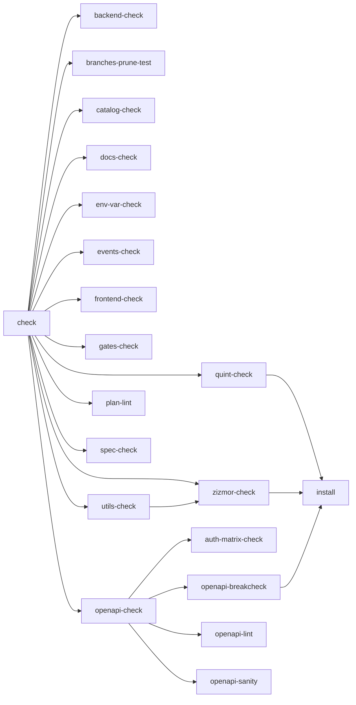
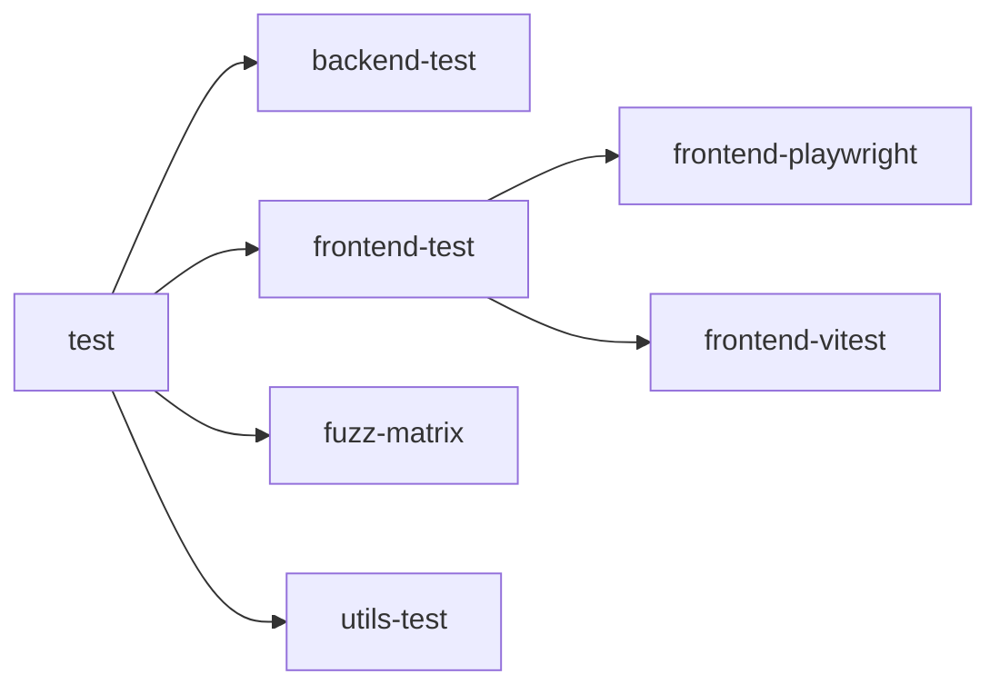

# Quality gates

Generated by `scripts/quality-gates.mjs` from the `justfile` and workflow files. Do not edit by hand.

## Rule graph

### `just check`

### `just test`

## Orphans (Called Manually)

Recipes with no associated CI workflow, no justfile parent caller, and not a global entry point (`precommit`, `check`, `test`, `audit`):

- `bench::clean`
- `bench::extract`
- `bench::format`
- `bench::lint`
- `bench::seed-images`
- `bench::server`
- `bench::test`
- `bench::workload`
- `branches-prune`
- `check-tools`
- `distclean`
- `docs-build`
- `docs-eventual-consistency`
- `docs-serve`
- `format`
- `fuzz-run`
- `fuzz-serve`
- `gates-docs`
- `install-plan`
- `plan`
- `plan-format`
- `run`
- `setup-dev`
- `test-release`
- `zizmor-check-online`

## Rules by group

`Rule` names the justfile recipe, `Params` lists its parameters, `Workflow` links the workflow files that invoke it, and `Trigger` lists what starts them (`local` is the pre-commit hook; the rest come from each workflow's `on:` block, narrowed by a job's `if:` when present, and `workflow_dispatch` is not listed because any workflow can expose it). A cross marks a rule that does not run there. Recipes are grouped by their justfile group.

### Backend

| Rule (justfile)         | Description                              | Params | Workflow                                    | Trigger             |
| ----------------------- | ---------------------------------------- | ------ | ------------------------------------------- | ------------------- |
| `backend-audit`         | cargo deny                               | —      | [audit](../.github/workflows/audit.yml)     | PR, main, scheduled |
| `backend-build`         | cargo build (dev build)                  | —      | ❌️                                          | ❌️                  |
| `backend-build-release` | cargo build (release build)              | —      | ❌️                                          | ❌️                  |
| `backend-check`         | cargo fmt --check + clippy (all targets) | —      | [ci](../.github/workflows/ci.yml)           | local, PR, main     |
| `backend-format`        | cargo fmt                                | —      | ❌️                                          | ❌️                  |
| `backend-test`          | Backend tests (cargo-nextest)            | —      | [ci](../.github/workflows/ci.yml)           | local, PR, main     |
| `backend-test-release`  | Backend tests in release mode            | —      | [release](../.github/workflows/release.yml) | tags                |

### Frontend

| Rule (justfile)       | Description                                                              | Params    | Workflow                                                                                   | Trigger               |
| --------------------- | ------------------------------------------------------------------------ | --------- | ------------------------------------------------------------------------------------------ | --------------------- |
| `frontend-audit`      | npm audit                                                                | —         | [audit](../.github/workflows/audit.yml)                                                    | PR, main, scheduled   |
| `frontend-build`      | npm run build; resyncs deps when package.json/lock changed since install | —         | [ci](../.github/workflows/ci.yml), [fuzz-advisory](../.github/workflows/fuzz-advisory.yml) | PR, main, scheduled   |
| `frontend-check`      | prettier --check + vue-tsc + eslint                                      | —         | [ci](../.github/workflows/ci.yml)                                                          | local, PR, main       |
| `frontend-format`     | prettier --write                                                         | —         | ❌️                                                                                         | ❌️                    |
| `frontend-playwright` | run playwright tests (optional filter)                                   | filter="" | [ci](../.github/workflows/ci.yml), [release](../.github/workflows/release.yml)             | local, PR, main, tags |
| `frontend-test`       | all frontend tests                                                       | —         | ❌️                                                                                         | local                 |
| `frontend-vitest`     | vitest run                                                               | —         | [ci](../.github/workflows/ci.yml)                                                          | local, PR, main       |

### Utils

| Rule (justfile)             | Description                                                                                 | Params | Workflow                                                                                   | Trigger             |
| --------------------------- | ------------------------------------------------------------------------------------------- | ------ | ------------------------------------------------------------------------------------------ | ------------------- |
| `auth-matrix-check`         | ensure auth-matrix artifacts match generator                                                | —      | [ci](../.github/workflows/ci.yml)                                                          | local, PR, main     |
| `catalog-check`             | Validate the goals, requirements, assumptions and scope catalogs + cross-catalog references | —      | ❌️                                                                                         | local               |
| `docs-eventual-consistency` | Regenerate docs/eventual-consistency.md from the JSON catalogs                              | —      | ❌️                                                                                         | ❌️                  |
| `dylint-check`              | run dylint auth lints (advisory)                                                            | —      | [ci](../.github/workflows/ci.yml)                                                          | PR, main            |
| `env-var-check`             | check PICASU_* env vars match docs/config.md                                                | —      | [ci](../.github/workflows/ci.yml)                                                          | local, PR, main     |
| `events-check`              | Validate the eventual-consistency event catalog                                             | —      | ❌️                                                                                         | local               |
| `fuzz-check`                | tier-1 gate: seeded sweep, baseline-compared                                                | —      | [ci](../.github/workflows/ci.yml), [fuzz-advisory](../.github/workflows/fuzz-advisory.yml) | PR, main, scheduled |
| `fuzz-matrix`               | run fuzz matrix (auth checks)                                                               | —      | [ci](../.github/workflows/ci.yml)                                                          | local, PR, main     |
| `fuzz-run`                  | run fuzz campaign (budget via FUZZ_MIN)                                                     | *args  | ❌️                                                                                         | ❌️                  |
| `fuzz-serve`                | —                                                                                           | *args  | ❌️                                                                                         | ❌️                  |
| `gates-check`               | ensure all test/check rules are called from CI and global rules                             | —      | [ci](../.github/workflows/ci.yml), [docs-check](../.github/workflows/docs-check.yml)       | local, PR, main     |
| `msrv-check`                | Non-blocking by design: MSRV floor check (nightly lane).                                    | —      | [msrv](../.github/workflows/msrv.yml)                                                      | scheduled           |
| `openapi-breakcheck`        | Fail on breaking OpenAPI changes                                                            | —      | [ci](../.github/workflows/ci.yml)                                                          | local, PR, main     |
| `openapi-check`             | Run all OpenAPI checks.                                                                     | —      | [ci](../.github/workflows/ci.yml)                                                          | local, PR, main     |
| `openapi-gen`               | Regenerate the checked-in OpenAPI artifact                                                  | —      | ❌️                                                                                         | ❌️                  |
| `openapi-lint`              | Lint the OpenAPI document (errors fail)                                                     | —      | [ci](../.github/workflows/ci.yml)                                                          | local, PR, main     |
| `openapi-routes-release`    | Run the already-built release binary's route-set gate against the committed spec.           | —      | [release](../.github/workflows/release.yml)                                                | tags                |
| `openapi-sanity`            | check OpenAPI annotation conventions                                                        | —      | [ci](../.github/workflows/ci.yml)                                                          | local, PR, main     |
| `plan`                      | run plan <args> (needs install-plan)                                                        | *args  | ❌️                                                                                         | ❌️                  |
| `plan-format`               | Auto-format .plan task frontmatter and body                                                 | —      | ❌️                                                                                         | ❌️                  |
| `plan-lint`                 | check .plan task frontmatter correctness                                                    | —      | [ci](../.github/workflows/ci.yml), [docs-check](../.github/workflows/docs-check.yml)       | local, PR, main     |
| `quint-check`               | Typecheck + test the eventual-consistency spec (Node-only, no JDK)                          | —      | ❌️                                                                                         | local               |
| `spec-check`                | node utils/quint/specs-check.mjs utils/quint/pipeline --generate                            | —      | ❌️                                                                                         | local               |
| `utils-check`               | utils fmt + clippy (all targets)                                                            | —      | [ci](../.github/workflows/ci.yml)                                                          | local, PR, main     |
| `utils-format`              | cargo fmt on utils/ crates                                                                  | —      | ❌️                                                                                         | ❌️                  |
| `utils-test`                | cargo test utils/ + Schemathesis derivations                                                | —      | [ci](../.github/workflows/ci.yml)                                                          | local, PR, main     |
| `zizmor-check`              | audit workflows/deps offline (no GH_TOKEN)                                                  | —      | [ci](../.github/workflows/ci.yml), [zizmor](../.github/workflows/zizmor.yml)               | local, PR, main     |
| `zizmor-check-online`       | e.g. --format=sarif                                                                         | *args  | ❌️                                                                                         | ❌️                  |

Note: `dylint-check` - needs nightly-2026-08-01 toolchain+rDylint; CI-only by decision 2026-11-05
Note: `fuzz-check` - CI-only tier-1 fuzz check not promoted into local `test` aggregate (step 3 pending)

### Docs

| Rule (justfile) | Description                                       | Params | Workflow                                                                             | Trigger         |
| --------------- | ------------------------------------------------- | ------ | ------------------------------------------------------------------------------------ | --------------- |
| `docs-build`    | Build mdBook site at target/docs/                 | —      | ❌️                                                                                   | ❌️              |
| `docs-check`    | check markdown (docs, .plan, utils)               | —      | [ci](../.github/workflows/ci.yml), [docs-check](../.github/workflows/docs-check.yml) | local, PR, main |
| `docs-format`   | format markdown (README, docs, .plan, utils)      | —      | ❌️                                                                                   | ❌️              |
| `docs-openapi`  | Generate OpenAPI spec and reference doc           | —      | ❌️                                                                                   | ❌️              |
| `docs-serve`    | Serve mdbook documentation                        | —      | ❌️                                                                                   | ❌️              |
| `gates-docs`    | Regenerate the gates doc (checked by gates-check) | —      | ❌️                                                                                   | ❌️              |

### Deps

| Rule (justfile) | Description                                                       | Params | Workflow                                                                                                                                                                                                                    | Trigger                          |
| --------------- | ----------------------------------------------------------------- | ------ | --------------------------------------------------------------------------------------------------------------------------------------------------------------------------------------------------------------------------- | -------------------------------- |
| `check-tools`   | verify installed tool versions                                    | —      | ❌️                                                                                                                                                                                                                          | ❌️                               |
| `install`       | dispatcher loops scripts/deps/*.sh                                | tool   | [audit](../.github/workflows/audit.yml), [ci](../.github/workflows/ci.yml), [fuzz-advisory](../.github/workflows/fuzz-advisory.yml), [release](../.github/workflows/release.yml), [zizmor](../.github/workflows/zizmor.yml) | local, PR, main, tags, scheduled |
| `install-dev`   | install managed dev tools                                         | —      | ❌️                                                                                                                                                                                                                          | ❌️                               |
| `install-plan`  | Install 'plan' and 'gloss' tools (pinned)                         | —      | ❌️                                                                                                                                                                                                                          | ❌️                               |
| `setup-dev`     | install dev tools + precommit hook                                | —      | ❌️                                                                                                                                                                                                                          | ❌️                               |
| `setup-sccache` | Generate gitignored .cargo/sccache.toml when sccache is installed | —      | ❌️                                                                                                                                                                                                                          | ❌️                               |

### Global

| Rule (justfile)       | Description                                                                | Params | Workflow                                | Trigger             |
| --------------------- | -------------------------------------------------------------------------- | ------ | --------------------------------------- | ------------------- |
| `audit`               | Run security audits (backend + frontend)                                   | —      | [audit](../.github/workflows/audit.yml) | PR, main, scheduled |
| `branches-prune`      | Prune stale local/remote branches (report; --apply + --expire-* to delete) | *args  | ❌️                                      | ❌️                  |
| `branches-prune-test` | Test the branch pruning helper against a fixture repository                | —      | ❌️                                      | local               |
| `build`               | Build frontend then backend (dev build)                                    | —      | ❌️                                      | ❌️                  |
| `build-release`       | Release build with embedded assets                                         | —      | ❌️                                      | ❌️                  |
| `check`               | Run all linters and static checks                                          | —      | ❌️                                      | local               |
| `clean`               | Remove transient generated state                                           | —      | ❌️                                      | ❌️                  |
| `distclean`           | Clean all generated files                                                  | —      | ❌️                                      | ❌️                  |
| `format`              | Format everything                                                          | —      | ❌️                                      | ❌️                  |
| `precommit`           | Run format, linter, static checks and tests                                | —      | ❌️                                      | local               |
| `run`                 | Build and run out of sandbox/{data,images}                                 | —      | ❌️                                      | ❌️                  |
| `test`                | run full test suite                                                        | —      | ❌️                                      | local               |
| `test-release`        | build + test release (webroot embedded)                                    | —      | ❌️                                      | ❌️                  |

### Bench

| Rule (justfile)      | Description                | Params                                                                | Workflow | Trigger |
| -------------------- | -------------------------- | --------------------------------------------------------------------- | -------- | ------- |
| `bench::clean`       | Remove the on-demand venv. | —                                                                     | ❌️       | ❌️      |
| `bench::extract`     | Extract cell metrics.      | *args                                                                 | ❌️       | ❌️      |
| `bench::format`      | Apply formatting.          | —                                                                     | ❌️       | ❌️      |
| `bench::lint`        | Lint + format check.       | —                                                                     | ❌️       | ❌️      |
| `bench::seed-images` | Seed an image repo.        | image_repo, images="100", template="", jobs="4"                       | ❌️       | ❌️      |
| `bench::server`      | Serve a backend cell.      | —                                                                     | ❌️       | ❌️      |
| `bench::test`        | Run the bench unit tests.  | —                                                                     | ❌️       | ❌️      |
| `bench::workload`    | Run a benchmark cell.      | out, image_repo, images="100", ncpu="8", build="release", port="5795" | ❌️       | ❌️      |
