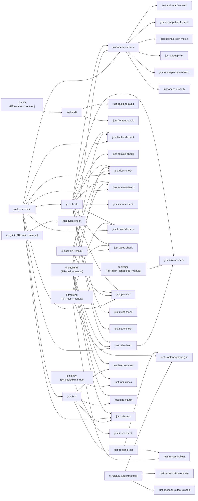

# Quality gates

Generated by `scripts/quality-gates.mjs` from the `justfile` and workflow files. Do not edit by hand.

## Lane graph

## Checks

### `audit`

Annotation: Run security audits (backend + frontend)

- Recipe: [justfile:505-505](https://github.com/codesam88/picasu/blob/main/justfile#L505-L505) `justfile:505-505`
- Lanes: audit
- Invocations:
  - [.github/workflows/audit.yml:50-50](https://github.com/codesam88/picasu/blob/main/.github/workflows/audit.yml#L50-L50) `.github/workflows/audit.yml:50-50`
- Required by: (none - lane entry)

### `auth-matrix-check`

Annotation: ensure auth-matrix artifacts match generator

- Recipe: [justfile:290-310](https://github.com/codesam88/picasu/blob/main/justfile#L290-L310) `justfile:290-310`
- Lanes: ci-backend, precommit
- Invocations: (none direct; reached via aggregate)
- Underlying:
  - [backend/auth-matrix.json:1-2153](https://github.com/codesam88/picasu/blob/main/backend/auth-matrix.json#L1-L2153) `backend/auth-matrix.json:1-2153`
  - [docs/auth-matrix.md:1-139](https://github.com/codesam88/picasu/blob/main/docs/auth-matrix.md#L1-L139) `docs/auth-matrix.md:1-139`
  - [scripts/auth-matrix.mjs:1-249](https://github.com/codesam88/picasu/blob/main/scripts/auth-matrix.mjs#L1-L249) `scripts/auth-matrix.mjs:1-249`
- Required by: `openapi-check`

### `backend-audit`

Annotation: cargo deny

- Recipe: [justfile:40-41](https://github.com/codesam88/picasu/blob/main/justfile#L40-L41) `justfile:40-41`
- Lanes: audit
- Invocations: (none direct; reached via aggregate)
- Required by: `audit`

### `backend-check`

Annotation: cargo fmt --check + clippy (all targets)

- Recipe: [justfile:19-21](https://github.com/codesam88/picasu/blob/main/justfile#L19-L21) `justfile:19-21`
- Lanes: ci-backend, precommit
- Invocations:
  - [.github/workflows/ci.yml:134-139](https://github.com/codesam88/picasu/blob/main/.github/workflows/ci.yml#L134-L139) `.github/workflows/ci.yml:134-139`
  - [justfile:524-524](https://github.com/codesam88/picasu/blob/main/justfile#L524-L524) `justfile:524-524`
- Required by: `check`

### `backend-test`

Annotation: Backend tests (cargo-nextest)

- Recipe: [justfile:30-31](https://github.com/codesam88/picasu/blob/main/justfile#L30-L31) `justfile:30-31`
- Lanes: ci-backend, precommit
- Invocations:
  - [.github/workflows/ci.yml:142-144](https://github.com/codesam88/picasu/blob/main/.github/workflows/ci.yml#L142-L144) `.github/workflows/ci.yml:142-144`
- Required by: `test`

### `backend-test-release`

Annotation: Backend tests in release mode

- Recipe: [justfile:35-36](https://github.com/codesam88/picasu/blob/main/justfile#L35-L36) `justfile:35-36`
- Lanes: release
- Invocations:
  - [.github/workflows/release.yml:120-122](https://github.com/codesam88/picasu/blob/main/.github/workflows/release.yml#L120-L122) `.github/workflows/release.yml:120-122`
- Required by: `test-release`

### `catalog-check`

Annotation: Validate the goals, requirements, assumptions and scope catalogs + cross-catalog references

- Recipe: [justfile:334-335](https://github.com/codesam88/picasu/blob/main/justfile#L334-L335) `justfile:334-335`
- Lanes: precommit
- Invocations: (none direct; reached via aggregate)
- Required by: `check`

### `docs-check`

Annotation: check markdown (docs, .plan, utils)

- Recipe: [justfile:401-402](https://github.com/codesam88/picasu/blob/main/justfile#L401-L402) `justfile:401-402`
- Lanes: ci-frontend, docs, precommit
- Invocations:
  - [.github/workflows/ci.yml:242-245](https://github.com/codesam88/picasu/blob/main/.github/workflows/ci.yml#L242-L245) `.github/workflows/ci.yml:242-245`
  - [.github/workflows/docs-check.yml:36-36](https://github.com/codesam88/picasu/blob/main/.github/workflows/docs-check.yml#L36-L36) `.github/workflows/docs-check.yml:36-36`
  - [justfile:539-539](https://github.com/codesam88/picasu/blob/main/justfile#L539-L539) `justfile:539-539`
- Required by: `check`

### `dylint-check`

Annotation: run dylint auth lints (advisory)

- Recipe: [justfile:160-161](https://github.com/codesam88/picasu/blob/main/justfile#L160-L161) `justfile:160-161`
- Lanes: ci-dylint
  Note: needs nightly-2026-08-01 toolchain+rDylint; CI-only by decision 2026-11-05
- Invocations:
  - [.github/workflows/ci.yml:291-291](https://github.com/codesam88/picasu/blob/main/.github/workflows/ci.yml#L291-L291) `.github/workflows/ci.yml:291-291`
- Required by: (none - lane entry)

### `env-var-check`

Annotation: check PICASU_* env vars match docs/config.md

- Recipe: [justfile:284-286](https://github.com/codesam88/picasu/blob/main/justfile#L284-L286) `justfile:284-286`
- Lanes: ci-backend, precommit
- Invocations:
  - [.github/workflows/ci.yml:134-139](https://github.com/codesam88/picasu/blob/main/.github/workflows/ci.yml#L134-L139) `.github/workflows/ci.yml:134-139`
  - [justfile:545-545](https://github.com/codesam88/picasu/blob/main/justfile#L545-L545) `justfile:545-545`
- Required by: `check`

### `events-check`

Annotation: Validate the eventual-consistency event catalog

- Recipe: [justfile:329-330](https://github.com/codesam88/picasu/blob/main/justfile#L329-L330) `justfile:329-330`
- Lanes: precommit
- Invocations: (none direct; reached via aggregate)
- Required by: `check`

### `frontend-audit`

Annotation: npm audit

- Recipe: [justfile:119-120](https://github.com/codesam88/picasu/blob/main/justfile#L119-L120) `justfile:119-120`
- Lanes: audit
- Invocations: (none direct; reached via aggregate)
- Required by: `audit`

### `frontend-check`

Annotation: prettier --check + vue-tsc + eslint

- Recipe: [justfile:62-63](https://github.com/codesam88/picasu/blob/main/justfile#L62-L63) `justfile:62-63`
- Lanes: ci-frontend, precommit
- Invocations:
  - [.github/workflows/ci.yml:242-245](https://github.com/codesam88/picasu/blob/main/.github/workflows/ci.yml#L242-L245) `.github/workflows/ci.yml:242-245`
  - [justfile:542-542](https://github.com/codesam88/picasu/blob/main/justfile#L542-L542) `justfile:542-542`
- Required by: `check`

### `frontend-playwright`

Annotation: run playwright tests (optional filter)

- Recipe: [justfile:72-98](https://github.com/codesam88/picasu/blob/main/justfile#L72-L98) `justfile:72-98`
- Lanes: ci-frontend, precommit, release
- Invocations:
  - [.github/workflows/ci.yml:248-250](https://github.com/codesam88/picasu/blob/main/.github/workflows/ci.yml#L248-L250) `.github/workflows/ci.yml:248-250`
  - [.github/workflows/release.yml:120-122](https://github.com/codesam88/picasu/blob/main/.github/workflows/release.yml#L120-L122) `.github/workflows/release.yml:120-122`
- Required by: `frontend-test`

### `frontend-test`

Annotation: all frontend tests

- Recipe: [justfile:102-102](https://github.com/codesam88/picasu/blob/main/justfile#L102-L102) `justfile:102-102`
- Lanes: ci-frontend, precommit, release
- Invocations: (none direct; reached via aggregate)
- Required by: `test`

### `frontend-vitest`

Annotation: vitest run

- Recipe: [justfile:67-68](https://github.com/codesam88/picasu/blob/main/justfile#L67-L68) `justfile:67-68`
- Lanes: ci-frontend, precommit
- Invocations:
  - [.github/workflows/ci.yml:248-250](https://github.com/codesam88/picasu/blob/main/.github/workflows/ci.yml#L248-L250) `.github/workflows/ci.yml:248-250`
- Required by: `frontend-test`

### `fuzz-check`

Annotation: tier-1 gate: seeded sweep, baseline-compared

- Recipe: [justfile:213-217](https://github.com/codesam88/picasu/blob/main/justfile#L213-L217) `justfile:213-217`
- Lanes: ci-backend, nightly
  Note: CI-only tier-1 fuzz check not promoted into local `test` aggregate (step 3 pending)
- Invocations:
  - [.github/workflows/ci.yml:151-151](https://github.com/codesam88/picasu/blob/main/.github/workflows/ci.yml#L151-L151) `.github/workflows/ci.yml:151-151`
  - [.github/workflows/fuzz-advisory.yml:87-87](https://github.com/codesam88/picasu/blob/main/.github/workflows/fuzz-advisory.yml#L87-L87) `.github/workflows/fuzz-advisory.yml:87-87`
- Underlying:
  - [scripts/deps-install.sh:1-83](https://github.com/codesam88/picasu/blob/main/scripts/deps-install.sh#L1-L83) `scripts/deps-install.sh:1-83`
  - [utils/schemathesis/check.sh:1-73](https://github.com/codesam88/picasu/blob/main/utils/schemathesis/check.sh#L1-L73) `utils/schemathesis/check.sh:1-73`
- Required by: (none - lane entry)

### `fuzz-matrix`

Annotation: run fuzz matrix (auth checks)

- Recipe: [justfile:222-223](https://github.com/codesam88/picasu/blob/main/justfile#L222-L223) `justfile:222-223`
- Lanes: ci-backend, precommit
- Invocations:
  - [.github/workflows/ci.yml:158-158](https://github.com/codesam88/picasu/blob/main/.github/workflows/ci.yml#L158-L158) `.github/workflows/ci.yml:158-158`
- Underlying:
  - [utils/schemathesis/fuzz_matrix.sh:1-42](https://github.com/codesam88/picasu/blob/main/utils/schemathesis/fuzz_matrix.sh#L1-L42) `utils/schemathesis/fuzz_matrix.sh:1-42`
- Required by: `test`

### `gates-check`

Annotation: ensure all test/check rules are called from CI and global rules

- Recipe: [justfile:353-354](https://github.com/codesam88/picasu/blob/main/justfile#L353-L354) `justfile:353-354`
- Lanes: ci-backend, docs, precommit
- Invocations:
  - [.github/workflows/ci.yml:134-139](https://github.com/codesam88/picasu/blob/main/.github/workflows/ci.yml#L134-L139) `.github/workflows/ci.yml:134-139`
  - [.github/workflows/docs-check.yml:38-38](https://github.com/codesam88/picasu/blob/main/.github/workflows/docs-check.yml#L38-L38) `.github/workflows/docs-check.yml:38-38`
- Required by: `check`

### `msrv-check`

Annotation: Non-blocking by design: MSRV floor check (nightly lane).

- Recipe: [justfile:255-261](https://github.com/codesam88/picasu/blob/main/justfile#L255-L261) `justfile:255-261`
- Lanes: nightly
- Invocations:
  - [.github/workflows/msrv.yml:40-40](https://github.com/codesam88/picasu/blob/main/.github/workflows/msrv.yml#L40-L40) `.github/workflows/msrv.yml:40-40`
- Required by: (none - lane entry)

### `openapi-breakcheck`

Annotation: Fail on breaking OpenAPI changes

- Recipe: [justfile:276-280](https://github.com/codesam88/picasu/blob/main/justfile#L276-L280) `justfile:276-280`
- Lanes: ci-backend, precommit
- Invocations: (none direct; reached via aggregate)
- Underlying:
  - [scripts/deps-install.sh:1-83](https://github.com/codesam88/picasu/blob/main/scripts/deps-install.sh#L1-L83) `scripts/deps-install.sh:1-83`
  - [scripts/openapi-breakcheck.sh:1-74](https://github.com/codesam88/picasu/blob/main/scripts/openapi-breakcheck.sh#L1-L74) `scripts/openapi-breakcheck.sh:1-74`
- Required by: `openapi-check`

### `openapi-check`

Annotation: Run all OpenAPI checks.

- Recipe: [justfile:156-156](https://github.com/codesam88/picasu/blob/main/justfile#L156-L156) `justfile:156-156`
- Lanes: ci-backend, precommit
- Invocations:
  - [.github/workflows/ci.yml:134-139](https://github.com/codesam88/picasu/blob/main/.github/workflows/ci.yml#L134-L139) `.github/workflows/ci.yml:134-139`
  - [justfile:525-525](https://github.com/codesam88/picasu/blob/main/justfile#L525-L525) `justfile:525-525`
  - [justfile:529-529](https://github.com/codesam88/picasu/blob/main/justfile#L529-L529) `justfile:529-529`
- Required by: `check`

### `openapi-json-match`

Annotation: Ensure that committed/staged json matches current --dump-openapi output

- Recipe: [justfile:187-199](https://github.com/codesam88/picasu/blob/main/justfile#L187-L199) `justfile:187-199`
- Lanes: ci-backend, precommit
- Invocations: (none direct; reached via aggregate)
- Underlying:
  - [backend/openapi.json:1-5863](https://github.com/codesam88/picasu/blob/main/backend/openapi.json#L1-L5863) `backend/openapi.json:1-5863`
- Required by: `openapi-check`

### `openapi-lint`

Annotation: Lint the OpenAPI document (errors fail)

- Recipe: [justfile:165-166](https://github.com/codesam88/picasu/blob/main/justfile#L165-L166) `justfile:165-166`
- Lanes: ci-backend, precommit
- Invocations: (none direct; reached via aggregate)
- Required by: `openapi-check`

### `openapi-routes-match`

Annotation: Compare mounted Rocket routes with documented OpenAPI operations.

- Recipe: [justfile:176-178](https://github.com/codesam88/picasu/blob/main/justfile#L176-L178) `justfile:176-178`
- Lanes: ci-backend, precommit
- Invocations: (none direct; reached via aggregate)
- Required by: `openapi-check`

### `openapi-routes-release`

Annotation: Run the already-built release binary's route-set gate against the committed spec.

- Recipe: [justfile:182-183](https://github.com/codesam88/picasu/blob/main/justfile#L182-L183) `justfile:182-183`
- Lanes: release
- Invocations:
  - [.github/workflows/release.yml:83-83](https://github.com/codesam88/picasu/blob/main/.github/workflows/release.yml#L83-L83) `.github/workflows/release.yml:83-83`
- Required by: (none - lane entry)

### `openapi-sanity`

Annotation: check OpenAPI annotation conventions

- Recipe: [justfile:170-171](https://github.com/codesam88/picasu/blob/main/justfile#L170-L171) `justfile:170-171`
- Lanes: ci-backend, precommit
- Invocations: (none direct; reached via aggregate)
- Required by: `openapi-check`

### `plan-lint`

Annotation: check .plan task frontmatter correctness

- Recipe: [justfile:324-325](https://github.com/codesam88/picasu/blob/main/justfile#L324-L325) `justfile:324-325`
- Lanes: ci-frontend, docs, precommit
- Invocations:
  - [.github/workflows/ci.yml:242-245](https://github.com/codesam88/picasu/blob/main/.github/workflows/ci.yml#L242-L245) `.github/workflows/ci.yml:242-245`
  - [.github/workflows/docs-check.yml:37-37](https://github.com/codesam88/picasu/blob/main/.github/workflows/docs-check.yml#L37-L37) `.github/workflows/docs-check.yml:37-37`
  - [justfile:538-538](https://github.com/codesam88/picasu/blob/main/justfile#L538-L538) `justfile:538-538`
- Required by: `check`

### `quint-check`

Annotation: Typecheck + test the eventual-consistency spec (Node-only, no JDK)

- Recipe: [justfile:249-251](https://github.com/codesam88/picasu/blob/main/justfile#L249-L251) `justfile:249-251`
- Lanes: precommit
- Invocations: (none direct; reached via aggregate)
- Required by: `check`

### `spec-check`

Annotation: node scripts/specs-check.mjs specs --generate

- Recipe: [justfile:348-349](https://github.com/codesam88/picasu/blob/main/justfile#L348-L349) `justfile:348-349`
- Lanes: precommit
- Invocations: (none direct; reached via aggregate)
- Required by: `check`

### `utils-check`

Annotation: utils fmt + clippy (all targets)

- Recipe: [justfile:131-133](https://github.com/codesam88/picasu/blob/main/justfile#L131-L133) `justfile:131-133`
- Lanes: ci-backend, ci-zizmor, precommit
- Invocations:
  - [.github/workflows/ci.yml:134-139](https://github.com/codesam88/picasu/blob/main/.github/workflows/ci.yml#L134-L139) `.github/workflows/ci.yml:134-139`
  - [justfile:532-532](https://github.com/codesam88/picasu/blob/main/justfile#L532-L532) `justfile:532-532`
- Required by: `check`

### `utils-test`

Annotation: cargo test utils/ + Schemathesis derivations

- Recipe: [justfile:137-139](https://github.com/codesam88/picasu/blob/main/justfile#L137-L139) `justfile:137-139`
- Lanes: ci-backend, precommit
- Invocations:
  - [.github/workflows/ci.yml:142-144](https://github.com/codesam88/picasu/blob/main/.github/workflows/ci.yml#L142-L144) `.github/workflows/ci.yml:142-144`
  - [justfile:535-535](https://github.com/codesam88/picasu/blob/main/justfile#L535-L535) `justfile:535-535`
- Required by: `test`

### `zizmor-check`

Annotation: audit workflows/deps offline (no GH_TOKEN)

- Recipe: [justfile:241-245](https://github.com/codesam88/picasu/blob/main/justfile#L241-L245) `justfile:241-245`
- Lanes: ci-backend, ci-zizmor, precommit
- Invocations:
  - [.github/workflows/zizmor.yml:58-58](https://github.com/codesam88/picasu/blob/main/.github/workflows/zizmor.yml#L58-L58) `.github/workflows/zizmor.yml:58-58`
- Underlying:
  - [scripts/deps-install.sh:1-83](https://github.com/codesam88/picasu/blob/main/scripts/deps-install.sh#L1-L83) `scripts/deps-install.sh:1-83`
  - [scripts/zizmor-run.sh:1-12](https://github.com/codesam88/picasu/blob/main/scripts/zizmor-run.sh#L1-L12) `scripts/zizmor-run.sh:1-12`
- Required by: `check`, `utils-check`
