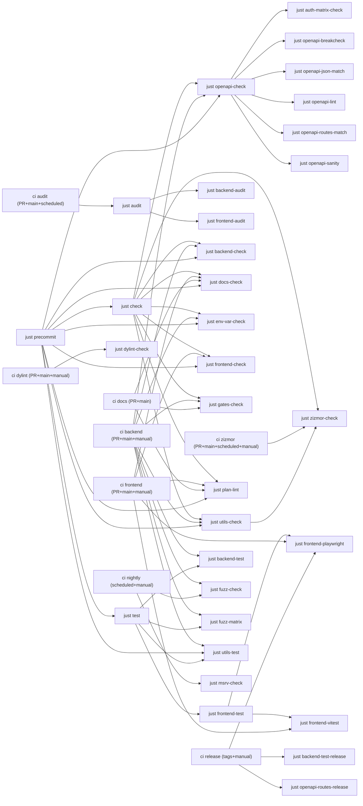

# Quality gates

Generated by `scripts/quality-gates.mjs` from the `justfile` and workflow files. Do not edit by hand.

## Lane graph

## Checks

### `audit`

Annotation: Run security audits (backend + frontend)

- Recipe: [justfile:444-444](https://github.com/codesam88/picasu/blob/main/justfile#L444-L444) `justfile:444-444`
- Lanes: audit
- Invocations:
  - [.github/workflows/audit.yml:48-48](https://github.com/codesam88/picasu/blob/main/.github/workflows/audit.yml#L48-L48) `.github/workflows/audit.yml:48-48`
- Required by: (none - lane entry)

### `auth-matrix-check`

Annotation: ensure auth-matrix artifacts match generator

- Recipe: [justfile:275-295](https://github.com/codesam88/picasu/blob/main/justfile#L275-L295) `justfile:275-295`
- Lanes: ci-backend, precommit
- Invocations: (none direct; reached via aggregate)
- Underlying:
  - [backend/auth-matrix.json:1-2152](https://github.com/codesam88/picasu/blob/main/backend/auth-matrix.json#L1-L2152) `backend/auth-matrix.json:1-2152`
  - [docs/auth-matrix.md:1-139](https://github.com/codesam88/picasu/blob/main/docs/auth-matrix.md#L1-L139) `docs/auth-matrix.md:1-139`
  - [scripts/auth-matrix.mjs:1-249](https://github.com/codesam88/picasu/blob/main/scripts/auth-matrix.mjs#L1-L249) `scripts/auth-matrix.mjs:1-249`
- Required by: `openapi-check`

### `backend-audit`

Annotation: cargo deny

- Recipe: [justfile:40-41](https://github.com/codesam88/picasu/blob/main/justfile#L40-L41) `justfile:40-41`
- Lanes: audit
- Invocations: (none direct; reached via aggregate)
- Required by: `audit`

### `backend-check`

Annotation: cargo fmt --check + clippy (all targets)

- Recipe: [justfile:19-21](https://github.com/codesam88/picasu/blob/main/justfile#L19-L21) `justfile:19-21`
- Lanes: ci-backend, precommit
- Invocations:
  - [.github/workflows/ci.yml:131-136](https://github.com/codesam88/picasu/blob/main/.github/workflows/ci.yml#L131-L136) `.github/workflows/ci.yml:131-136`
  - [justfile:463-463](https://github.com/codesam88/picasu/blob/main/justfile#L463-L463) `justfile:463-463`
- Required by: `check`

### `backend-test`

Annotation: Backend tests (cargo-nextest)

- Recipe: [justfile:30-31](https://github.com/codesam88/picasu/blob/main/justfile#L30-L31) `justfile:30-31`
- Lanes: ci-backend, precommit
- Invocations:
  - [.github/workflows/ci.yml:139-141](https://github.com/codesam88/picasu/blob/main/.github/workflows/ci.yml#L139-L141) `.github/workflows/ci.yml:139-141`
- Required by: `test`

### `backend-test-release`

Annotation: Backend tests in release mode

- Recipe: [justfile:35-36](https://github.com/codesam88/picasu/blob/main/justfile#L35-L36) `justfile:35-36`
- Lanes: release
- Invocations:
  - [.github/workflows/release.yml:126-128](https://github.com/codesam88/picasu/blob/main/.github/workflows/release.yml#L126-L128) `.github/workflows/release.yml:126-128`
- Required by: `test-release`

### `docs-check`

Annotation: check markdown (docs, .plan, utils)

- Recipe: [justfile:362-363](https://github.com/codesam88/picasu/blob/main/justfile#L362-L363) `justfile:362-363`
- Lanes: ci-frontend, docs, precommit
- Invocations:
  - [.github/workflows/ci.yml:236-239](https://github.com/codesam88/picasu/blob/main/.github/workflows/ci.yml#L236-L239) `.github/workflows/ci.yml:236-239`
  - [.github/workflows/docs-check.yml:34-34](https://github.com/codesam88/picasu/blob/main/.github/workflows/docs-check.yml#L34-L34) `.github/workflows/docs-check.yml:34-34`
  - [justfile:478-478](https://github.com/codesam88/picasu/blob/main/justfile#L478-L478) `justfile:478-478`
- Required by: `check`

### `dylint-check`

Annotation: run dylint auth lints (advisory)

- Recipe: [justfile:151-152](https://github.com/codesam88/picasu/blob/main/justfile#L151-L152) `justfile:151-152`
- Lanes: ci-dylint
  Note: needs nightly-2026-08-01 toolchain+rDylint; CI-only by decision 2026-11-05
- Invocations:
  - [.github/workflows/ci.yml:282-282](https://github.com/codesam88/picasu/blob/main/.github/workflows/ci.yml#L282-L282) `.github/workflows/ci.yml:282-282`
- Required by: (none - lane entry)

### `env-var-check`

Annotation: check PICASU_* env vars match docs/config.md

- Recipe: [justfile:269-271](https://github.com/codesam88/picasu/blob/main/justfile#L269-L271) `justfile:269-271`
- Lanes: ci-backend, precommit
- Invocations:
  - [.github/workflows/ci.yml:131-136](https://github.com/codesam88/picasu/blob/main/.github/workflows/ci.yml#L131-L136) `.github/workflows/ci.yml:131-136`
  - [justfile:484-484](https://github.com/codesam88/picasu/blob/main/justfile#L484-L484) `justfile:484-484`
- Required by: `check`

### `frontend-audit`

Annotation: npm audit

- Recipe: [justfile:115-116](https://github.com/codesam88/picasu/blob/main/justfile#L115-L116) `justfile:115-116`
- Lanes: audit
- Invocations: (none direct; reached via aggregate)
- Required by: `audit`

### `frontend-check`

Annotation: prettier --check + vue-tsc + eslint

- Recipe: [justfile:62-63](https://github.com/codesam88/picasu/blob/main/justfile#L62-L63) `justfile:62-63`
- Lanes: ci-frontend, precommit
- Invocations:
  - [.github/workflows/ci.yml:236-239](https://github.com/codesam88/picasu/blob/main/.github/workflows/ci.yml#L236-L239) `.github/workflows/ci.yml:236-239`
  - [justfile:481-481](https://github.com/codesam88/picasu/blob/main/justfile#L481-L481) `justfile:481-481`
- Required by: `check`

### `frontend-playwright`

Annotation: run playwright tests (optional filter)

- Recipe: [justfile:72-98](https://github.com/codesam88/picasu/blob/main/justfile#L72-L98) `justfile:72-98`
- Lanes: ci-frontend, precommit, release
- Invocations:
  - [.github/workflows/ci.yml:242-244](https://github.com/codesam88/picasu/blob/main/.github/workflows/ci.yml#L242-L244) `.github/workflows/ci.yml:242-244`
  - [.github/workflows/release.yml:126-128](https://github.com/codesam88/picasu/blob/main/.github/workflows/release.yml#L126-L128) `.github/workflows/release.yml:126-128`
- Required by: `frontend-test`

### `frontend-test`

Annotation: all frontend tests

- Recipe: [justfile:102-102](https://github.com/codesam88/picasu/blob/main/justfile#L102-L102) `justfile:102-102`
- Lanes: ci-frontend, precommit, release
- Invocations: (none direct; reached via aggregate)
- Required by: `test`

### `frontend-vitest`

Annotation: vitest run

- Recipe: [justfile:67-68](https://github.com/codesam88/picasu/blob/main/justfile#L67-L68) `justfile:67-68`
- Lanes: ci-frontend, precommit
- Invocations:
  - [.github/workflows/ci.yml:242-244](https://github.com/codesam88/picasu/blob/main/.github/workflows/ci.yml#L242-L244) `.github/workflows/ci.yml:242-244`
- Required by: `frontend-test`

### `fuzz-check`

Annotation: tier-1 gate: seeded sweep, baseline-compared

- Recipe: [justfile:204-208](https://github.com/codesam88/picasu/blob/main/justfile#L204-L208) `justfile:204-208`
- Lanes: ci-backend, nightly
  Note: CI-only tier-1 fuzz check not promoted into local `test` aggregate (step 3 pending)
- Invocations:
  - [.github/workflows/ci.yml:148-148](https://github.com/codesam88/picasu/blob/main/.github/workflows/ci.yml#L148-L148) `.github/workflows/ci.yml:148-148`
  - [.github/workflows/fuzz-advisory.yml:84-84](https://github.com/codesam88/picasu/blob/main/.github/workflows/fuzz-advisory.yml#L84-L84) `.github/workflows/fuzz-advisory.yml:84-84`
- Underlying:
  - [scripts/deps-install.sh:1-83](https://github.com/codesam88/picasu/blob/main/scripts/deps-install.sh#L1-L83) `scripts/deps-install.sh:1-83`
  - [utils/schemathesis/check.sh:1-73](https://github.com/codesam88/picasu/blob/main/utils/schemathesis/check.sh#L1-L73) `utils/schemathesis/check.sh:1-73`
- Required by: (none - lane entry)

### `fuzz-matrix`

Annotation: run fuzz matrix (auth checks)

- Recipe: [justfile:213-214](https://github.com/codesam88/picasu/blob/main/justfile#L213-L214) `justfile:213-214`
- Lanes: ci-backend, precommit
- Invocations:
  - [.github/workflows/ci.yml:155-155](https://github.com/codesam88/picasu/blob/main/.github/workflows/ci.yml#L155-L155) `.github/workflows/ci.yml:155-155`
- Underlying:
  - [utils/schemathesis/fuzz_matrix.sh:1-42](https://github.com/codesam88/picasu/blob/main/utils/schemathesis/fuzz_matrix.sh#L1-L42) `utils/schemathesis/fuzz_matrix.sh:1-42`
- Required by: `test`

### `gates-check`

Annotation: ensure all test/check rules are called from CI and global rules

- Recipe: [justfile:314-315](https://github.com/codesam88/picasu/blob/main/justfile#L314-L315) `justfile:314-315`
- Lanes: ci-backend, docs, precommit
- Invocations:
  - [.github/workflows/ci.yml:131-136](https://github.com/codesam88/picasu/blob/main/.github/workflows/ci.yml#L131-L136) `.github/workflows/ci.yml:131-136`
  - [.github/workflows/docs-check.yml:36-36](https://github.com/codesam88/picasu/blob/main/.github/workflows/docs-check.yml#L36-L36) `.github/workflows/docs-check.yml:36-36`
- Required by: `check`

### `msrv-check`

Annotation: Non-blocking by design: MSRV floor check (nightly lane).

- Recipe: [justfile:240-246](https://github.com/codesam88/picasu/blob/main/justfile#L240-L246) `justfile:240-246`
- Lanes: nightly
- Invocations:
  - [.github/workflows/msrv.yml:37-37](https://github.com/codesam88/picasu/blob/main/.github/workflows/msrv.yml#L37-L37) `.github/workflows/msrv.yml:37-37`
- Required by: (none - lane entry)

### `openapi-breakcheck`

Annotation: Fail on breaking OpenAPI changes

- Recipe: [justfile:261-265](https://github.com/codesam88/picasu/blob/main/justfile#L261-L265) `justfile:261-265`
- Lanes: ci-backend, precommit
- Invocations: (none direct; reached via aggregate)
- Underlying:
  - [scripts/deps-install.sh:1-83](https://github.com/codesam88/picasu/blob/main/scripts/deps-install.sh#L1-L83) `scripts/deps-install.sh:1-83`
  - [scripts/openapi-breakcheck.sh:1-74](https://github.com/codesam88/picasu/blob/main/scripts/openapi-breakcheck.sh#L1-L74) `scripts/openapi-breakcheck.sh:1-74`
- Required by: `openapi-check`

### `openapi-check`

Annotation: Run all OpenAPI checks.

- Recipe: [justfile:147-147](https://github.com/codesam88/picasu/blob/main/justfile#L147-L147) `justfile:147-147`
- Lanes: ci-backend, precommit
- Invocations:
  - [.github/workflows/ci.yml:131-136](https://github.com/codesam88/picasu/blob/main/.github/workflows/ci.yml#L131-L136) `.github/workflows/ci.yml:131-136`
  - [justfile:464-464](https://github.com/codesam88/picasu/blob/main/justfile#L464-L464) `justfile:464-464`
  - [justfile:468-468](https://github.com/codesam88/picasu/blob/main/justfile#L468-L468) `justfile:468-468`
- Required by: `check`

### `openapi-json-match`

Annotation: Ensure that committed/staged json matches current --dump-openapi output

- Recipe: [justfile:178-190](https://github.com/codesam88/picasu/blob/main/justfile#L178-L190) `justfile:178-190`
- Lanes: ci-backend, precommit
- Invocations: (none direct; reached via aggregate)
- Underlying:
  - [backend/openapi.json:1-5859](https://github.com/codesam88/picasu/blob/main/backend/openapi.json#L1-L5859) `backend/openapi.json:1-5859`
- Required by: `openapi-check`

### `openapi-lint`

Annotation: Lint the OpenAPI document (errors fail)

- Recipe: [justfile:156-157](https://github.com/codesam88/picasu/blob/main/justfile#L156-L157) `justfile:156-157`
- Lanes: ci-backend, precommit
- Invocations: (none direct; reached via aggregate)
- Required by: `openapi-check`

### `openapi-routes-match`

Annotation: Compare mounted Rocket routes with documented OpenAPI operations.

- Recipe: [justfile:167-169](https://github.com/codesam88/picasu/blob/main/justfile#L167-L169) `justfile:167-169`
- Lanes: ci-backend, precommit
- Invocations: (none direct; reached via aggregate)
- Required by: `openapi-check`

### `openapi-routes-release`

Annotation: Run the already-built release binary's route-set gate against the committed spec.

- Recipe: [justfile:173-174](https://github.com/codesam88/picasu/blob/main/justfile#L173-L174) `justfile:173-174`
- Lanes: release
- Invocations:
  - [.github/workflows/release.yml:79-79](https://github.com/codesam88/picasu/blob/main/.github/workflows/release.yml#L79-L79) `.github/workflows/release.yml:79-79`
- Required by: (none - lane entry)

### `openapi-sanity`

Annotation: check OpenAPI annotation conventions

- Recipe: [justfile:161-162](https://github.com/codesam88/picasu/blob/main/justfile#L161-L162) `justfile:161-162`
- Lanes: ci-backend, precommit
- Invocations: (none direct; reached via aggregate)
- Required by: `openapi-check`

### `plan-lint`

Annotation: check .plan task frontmatter correctness

- Recipe: [justfile:309-310](https://github.com/codesam88/picasu/blob/main/justfile#L309-L310) `justfile:309-310`
- Lanes: ci-frontend, docs, precommit
- Invocations:
  - [.github/workflows/ci.yml:236-239](https://github.com/codesam88/picasu/blob/main/.github/workflows/ci.yml#L236-L239) `.github/workflows/ci.yml:236-239`
  - [.github/workflows/docs-check.yml:35-35](https://github.com/codesam88/picasu/blob/main/.github/workflows/docs-check.yml#L35-L35) `.github/workflows/docs-check.yml:35-35`
  - [justfile:477-477](https://github.com/codesam88/picasu/blob/main/justfile#L477-L477) `justfile:477-477`
- Required by: `check`

### `utils-check`

Annotation: utils fmt + clippy (all targets)

- Recipe: [justfile:127-129](https://github.com/codesam88/picasu/blob/main/justfile#L127-L129) `justfile:127-129`
- Lanes: ci-backend, ci-zizmor, precommit
- Invocations:
  - [.github/workflows/ci.yml:131-136](https://github.com/codesam88/picasu/blob/main/.github/workflows/ci.yml#L131-L136) `.github/workflows/ci.yml:131-136`
  - [justfile:471-471](https://github.com/codesam88/picasu/blob/main/justfile#L471-L471) `justfile:471-471`
- Required by: `check`

### `utils-test`

Annotation: cargo test utils/ + Schemathesis derivations

- Recipe: [justfile:133-135](https://github.com/codesam88/picasu/blob/main/justfile#L133-L135) `justfile:133-135`
- Lanes: ci-backend, precommit
- Invocations:
  - [.github/workflows/ci.yml:139-141](https://github.com/codesam88/picasu/blob/main/.github/workflows/ci.yml#L139-L141) `.github/workflows/ci.yml:139-141`
  - [justfile:474-474](https://github.com/codesam88/picasu/blob/main/justfile#L474-L474) `justfile:474-474`
- Required by: `test`

### `zizmor-check`

Annotation: audit workflows/deps offline (no GH_TOKEN)

- Recipe: [justfile:232-236](https://github.com/codesam88/picasu/blob/main/justfile#L232-L236) `justfile:232-236`
- Lanes: ci-backend, ci-zizmor, precommit
- Invocations:
  - [.github/workflows/zizmor.yml:55-55](https://github.com/codesam88/picasu/blob/main/.github/workflows/zizmor.yml#L55-L55) `.github/workflows/zizmor.yml:55-55`
- Underlying:
  - [scripts/deps-install.sh:1-83](https://github.com/codesam88/picasu/blob/main/scripts/deps-install.sh#L1-L83) `scripts/deps-install.sh:1-83`
  - [scripts/zizmor-run.sh:1-12](https://github.com/codesam88/picasu/blob/main/scripts/zizmor-run.sh#L1-L12) `scripts/zizmor-run.sh:1-12`
- Required by: `check`, `utils-check`
