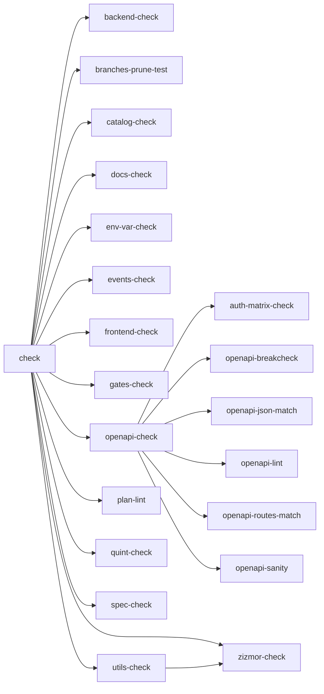
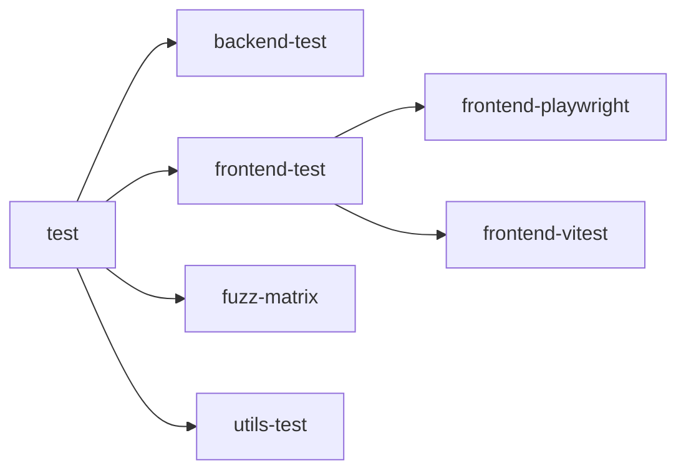

# Quality gates

Generated by `scripts/quality-gates.mjs` from the `justfile` and workflow files. Do not edit by hand.

## Rule graph

### `just check`

### `just test`

Rules outside `check` and `test`: `audit`, `backend-audit`, `backend-test-release`, `dylint-check`, `frontend-audit`, `fuzz-check`, `msrv-check`, `openapi-routes-release`.

## Orphans (Called Manually)

Rules with no associated CI lane, no justfile parent caller, and not in the `global` group:

None.

## Check families

`Rule` names the justfile recipe, `CI Lane` lists the workflow lanes it runs in, and `Trigger` lists what starts them (`local` is the pre-commit hook; the rest come from each workflow's `on:` block, narrowed by a job's `if:` when present, and `workflow_dispatch` is not listed because any workflow can expose it). A cross marks a rule that does not run there.

### Backend (Rust)

| Rule (justfile)        | Description                                              | CI Lane               | Trigger         |
| ---------------------- | -------------------------------------------------------- | --------------------- | --------------- |
| `backend-check`        | cargo fmt --check + clippy (all targets)                 | ci-backend            | local, PR, main |
| `backend-test`         | Backend tests (cargo-nextest)                            | ci-backend            | local, PR, main |
| `backend-test-release` | Backend tests in release mode                            | release               | tags            |
| `utils-check`          | utils fmt + clippy (all targets)                         | ci-backend, ci-zizmor | local, PR, main |
| `utils-test`           | cargo test utils/ + Schemathesis derivations             | ci-backend            | local, PR, main |
| `msrv-check`           | Non-blocking by design: MSRV floor check (nightly lane). | nightly               | scheduled       |

### Frontend

| Rule (justfile)       | Description                            | CI Lane              | Trigger               |
| --------------------- | -------------------------------------- | -------------------- | --------------------- |
| `frontend-check`      | prettier --check + vue-tsc + eslint    | ci-frontend          | local, PR, main       |
| `frontend-vitest`     | vitest run                             | ci-frontend          | local, PR, main       |
| `frontend-playwright` | run playwright tests (optional filter) | ci-frontend, release | local, PR, main, tags |
| `frontend-test`       | all frontend tests                     | ci-frontend, release | local, PR, main, tags |

### API contract

| Rule (justfile)          | Description                                                                       | CI Lane    | Trigger         |
| ------------------------ | --------------------------------------------------------------------------------- | ---------- | --------------- |
| `openapi-check`          | Run all OpenAPI checks.                                                           | ci-backend | local, PR, main |
| `openapi-breakcheck`     | Fail on breaking OpenAPI changes                                                  | ci-backend | local, PR, main |
| `openapi-json-match`     | Ensure that committed/staged json matches current --dump-openapi output           | ci-backend | local, PR, main |
| `openapi-lint`           | Lint the OpenAPI document (errors fail)                                           | ci-backend | local, PR, main |
| `openapi-routes-match`   | Compare mounted Rocket routes with documented OpenAPI operations.                 | ci-backend | local, PR, main |
| `openapi-routes-release` | Run the already-built release binary's route-set gate against the committed spec. | release    | tags            |
| `openapi-sanity`         | check OpenAPI annotation conventions                                              | ci-backend | local, PR, main |
| `auth-matrix-check`      | ensure auth-matrix artifacts match generator                                      | ci-backend | local, PR, main |

### Security & supply chain

| Rule (justfile)  | Description                                | CI Lane               | Trigger             |
| ---------------- | ------------------------------------------ | --------------------- | ------------------- |
| `audit`          | Run security audits (backend + frontend)   | audit                 | PR, main, scheduled |
| `backend-audit`  | cargo deny                                 | audit                 | PR, main, scheduled |
| `frontend-audit` | npm audit                                  | audit                 | PR, main, scheduled |
| `zizmor-check`   | audit workflows/deps offline (no GH_TOKEN) | ci-backend, ci-zizmor | local, PR, main     |
| `dylint-check`   | run dylint auth lints (advisory)           | ci-dylint             | PR, main            |

Note: `dylint-check` - needs nightly-2026-08-01 toolchain+rDylint; CI-only by decision 2026-11-05

### Fuzzing

| Rule (justfile) | Description                                  | CI Lane             | Trigger             |
| --------------- | -------------------------------------------- | ------------------- | ------------------- |
| `fuzz-check`    | tier-1 gate: seeded sweep, baseline-compared | ci-backend, nightly | PR, main, scheduled |
| `fuzz-matrix`   | run fuzz matrix (auth checks)                | ci-backend          | local, PR, main     |

Note: `fuzz-check` - CI-only tier-1 fuzz check not promoted into local `test` aggregate (step 3 pending)

### Specs & catalogs

| Rule (justfile) | Description                                                                                 | CI Lane | Trigger |
| --------------- | ------------------------------------------------------------------------------------------- | ------- | ------- |
| `quint-check`   | Typecheck + test the eventual-consistency spec (Node-only, no JDK)                          | ❌️      | local   |
| `spec-check`    | node utils/quint/specs-check.mjs utils/quint/pipeline --generate                            | ❌️      | local   |
| `events-check`  | Validate the eventual-consistency event catalog                                             | ❌️      | local   |
| `catalog-check` | Validate the goals, requirements, assumptions and scope catalogs + cross-catalog references | ❌️      | local   |

### Repo & docs hygiene

| Rule (justfile)       | Description                                                     | CI Lane           | Trigger         |
| --------------------- | --------------------------------------------------------------- | ----------------- | --------------- |
| `docs-check`          | check markdown (docs, .plan, utils)                             | ci-frontend, docs | local, PR, main |
| `plan-lint`           | check .plan task frontmatter correctness                        | ci-frontend, docs | local, PR, main |
| `env-var-check`       | check PICASU_* env vars match docs/config.md                    | ci-backend        | local, PR, main |
| `gates-check`         | ensure all test/check rules are called from CI and global rules | ci-backend, docs  | local, PR, main |
| `branches-prune-test` | Test the branch pruning helper against a fixture repository     | ❌️                | local           |
