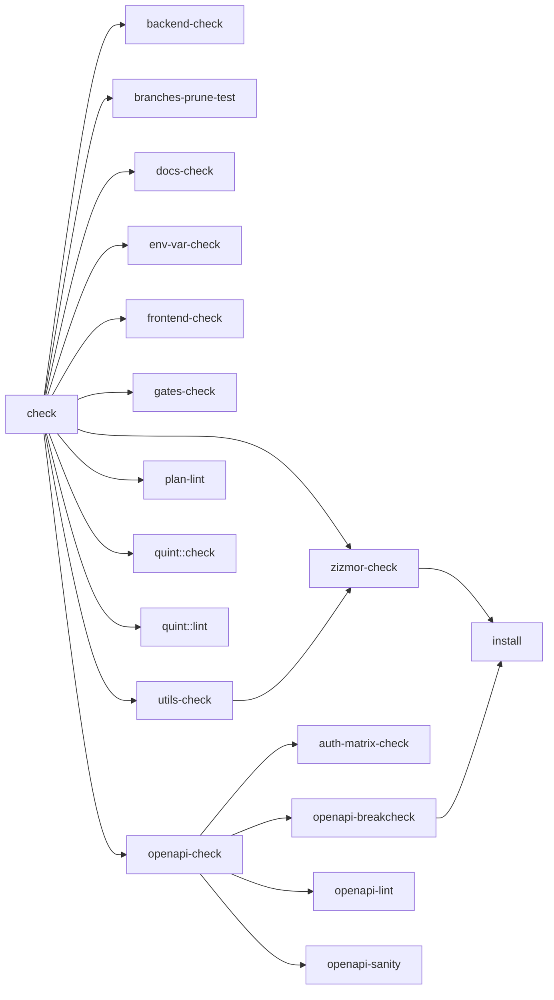
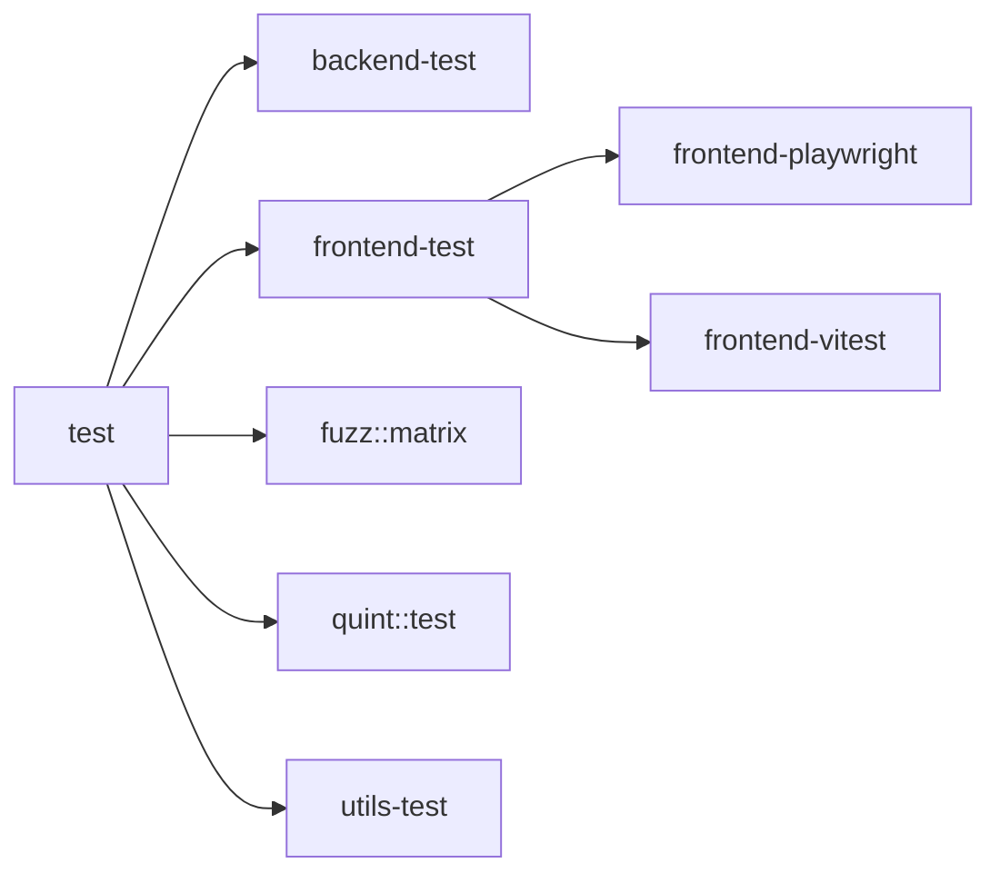
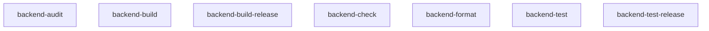
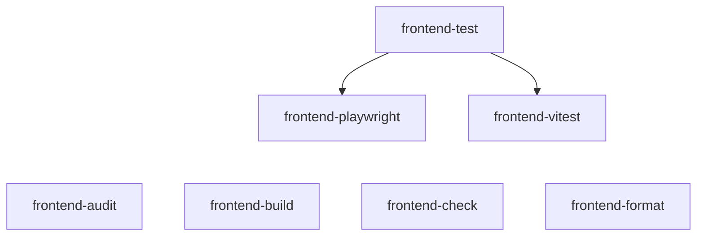
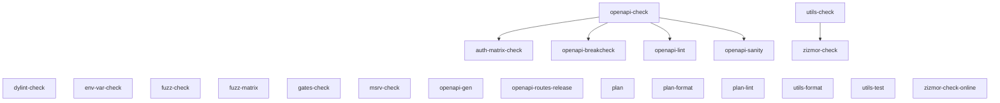
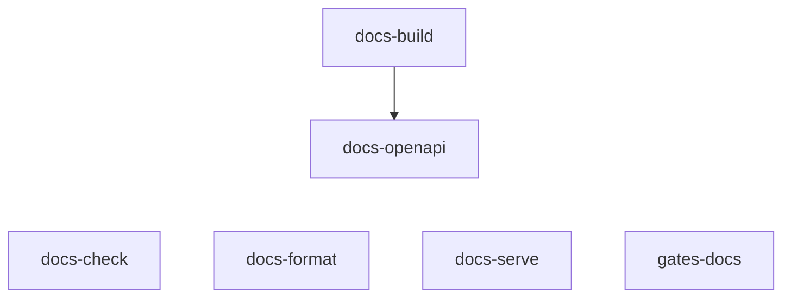
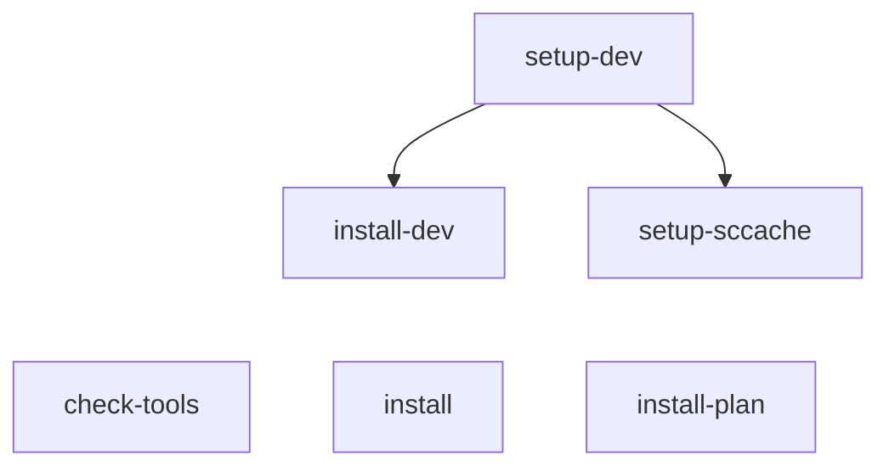
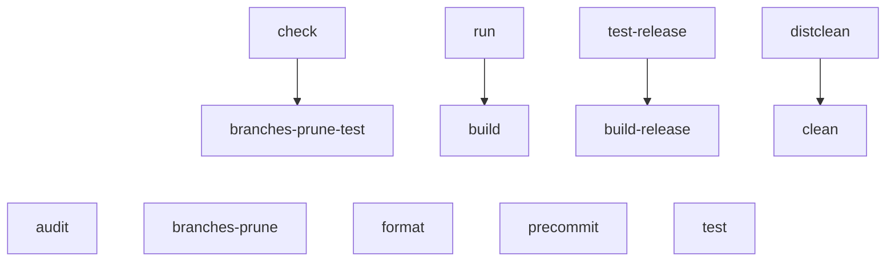
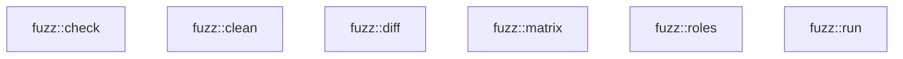
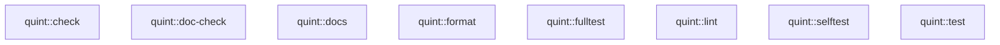

# Quality gates

Generated by `scripts/quality-gates.mjs` from the `justfile` and workflow files. Do not edit by hand.

## Test and Check Flows

### `just check`

### `just test`

## Orphans (not reachable from a global rule or CI workflow)

| Orphan                  | Orphan                |
| ----------------------- | --------------------- |
| `backend-build`         | `docs-serve`          |
| `backend-build-release` | `format`              |
| `backend-format`        | `frontend-format`     |
| `bench::battery`        | `fuzz::clean`         |
| `bench::battery-check`  | `fuzz::diff`          |
| `bench::clean`          | `fuzz::roles`         |
| `bench::extract`        | `fuzz::run`           |
| `bench::format`         | `gates-docs`          |
| `bench::lint`           | `install-dev`         |
| `bench::prepare`        | `install-plan`        |
| `bench::run`            | `openapi-gen`         |
| `bench::seed-images`    | `plan`                |
| `bench::server`         | `plan-format`         |
| `bench::status`         | `quint::doc-check`    |
| `bench::test`           | `quint::docs`         |
| `branches-prune`        | `quint::format`       |
| `build`                 | `quint::fulltest`     |
| `build-release`         | `quint::selftest`     |
| `check-tools`           | `run`                 |
| `clean`                 | `setup-dev`           |
| `distclean`             | `setup-sccache`       |
| `docs-build`            | `test-release`        |
| `docs-format`           | `utils-format`        |
| `docs-openapi`          | `zizmor-check-online` |

## Rules by group

`Rule` names the justfile recipe, `CI Workflow` lists the workflow files that invoke it directly and, in parentheses, any caller that itself runs in CI, and `Trigger` lists what starts them (`local` is the pre-commit hook; the rest come from each workflow's `on:` block, narrowed by a job's `if:` when present, and `workflow_dispatch` is not listed because any workflow can expose it). A cross marks a recipe with no workflow or CI caller; a dash marks no trigger. Recipes are grouped by their justfile group.

### Backend

| Rule (justfile)         | Description                              | CI Workflow | Trigger             |
| ----------------------- | ---------------------------------------- | ----------- | ------------------- |
| `backend-audit`         | cargo deny                               | (audit)     | PR, main, scheduled |
| `backend-build`         | cargo build (dev build)                  | ❌️          | -                   |
| `backend-build-release` | cargo build (release build)              | ❌️          | -                   |
| `backend-check`         | cargo fmt --check + clippy (all targets) | ci          | local, PR, main     |
| `backend-format`        | cargo fmt                                | ❌️          | -                   |
| `backend-test`          | Backend tests (cargo-nextest)            | ci          | local, PR, main     |
| `backend-test-release`  | Backend tests in release mode            | release     | tags                |

### Frontend

| Rule (justfile)       | Description                                                              | CI Workflow       | Trigger               |
| --------------------- | ------------------------------------------------------------------------ | ----------------- | --------------------- |
| `frontend-audit`      | npm audit                                                                | (audit)           | PR, main, scheduled   |
| `frontend-build`      | npm run build; resyncs deps when package.json/lock changed since install | ci, fuzz-advisory | PR, main, scheduled   |
| `frontend-check`      | prettier --check + vue-tsc + eslint                                      | ci                | local, PR, main       |
| `frontend-format`     | prettier --write                                                         | ❌️                | -                     |
| `frontend-playwright` | run playwright tests (optional filter)                                   | ci, release       | local, PR, main, tags |
| `frontend-test`       | all frontend tests                                                       | ❌️                | local                 |
| `frontend-vitest`     | vitest run                                                               | ci                | local, PR, main       |

### Utils

| Rule (justfile)          | Description                                                                       | CI Workflow           | Trigger             |
| ------------------------ | --------------------------------------------------------------------------------- | --------------------- | ------------------- |
| `auth-matrix-check`      | ensure auth-matrix artifacts match generator                                      | (openapi-check)       | local, PR, main     |
| `dylint-check`           | run dylint auth lints (advisory)                                                  | ci                    | PR, main            |
| `env-var-check`          | check PICASU_* env vars match docs/config.md                                      | ci                    | local, PR, main     |
| `fuzz-check`             | Deprecated: CI invokes this name; use `just fuzz check`.                          | ci, fuzz-advisory     | PR, main, scheduled |
| `fuzz-matrix`            | Deprecated: CI invokes this name; use `just fuzz matrix`.                         | ci                    | PR, main            |
| `gates-check`            | ensure all test/check rules are called from CI and global rules                   | ci, docs-check        | local, PR, main     |
| `msrv-check`             | Non-blocking by design: MSRV floor check (nightly lane).                          | msrv                  | scheduled           |
| `openapi-breakcheck`     | Fail on breaking OpenAPI changes                                                  | (openapi-check)       | local, PR, main     |
| `openapi-check`          | Run all OpenAPI checks.                                                           | ci                    | local, PR, main     |
| `openapi-gen`            | Regenerate the checked-in OpenAPI artifact                                        | ❌️                    | -                   |
| `openapi-lint`           | Lint the OpenAPI document (errors fail)                                           | (openapi-check)       | local, PR, main     |
| `openapi-routes-release` | Run the already-built release binary's route-set gate against the committed spec. | release               | tags                |
| `openapi-sanity`         | check OpenAPI annotation conventions                                              | (openapi-check)       | local, PR, main     |
| `plan`                   | run plan <args> (needs install-plan)                                              | ❌️                    | -                   |
| `plan-format`            | Auto-format .plan task frontmatter and body                                       | ❌️                    | -                   |
| `plan-lint`              | check .plan task frontmatter correctness                                          | ci, docs-check        | local, PR, main     |
| `utils-check`            | utils fmt + clippy (all targets)                                                  | ci                    | local, PR, main     |
| `utils-format`           | cargo fmt on utils/ crates                                                        | ❌️                    | -                   |
| `utils-test`             | cargo test utils/ + Schemathesis derivations                                      | ci                    | local, PR, main     |
| `zizmor-check`           | audit workflows/deps offline (no GH_TOKEN)                                        | zizmor, (utils-check) | local, PR, main     |
| `zizmor-check-online`    | e.g. --format=sarif                                                               | ❌️                    | -                   |

Note: `dylint-check` - needs nightly-2026-08-01 toolchain+rDylint; CI-only by decision 2026-11-05

### Docs

| Rule (justfile) | Description                                       | CI Workflow    | Trigger         |
| --------------- | ------------------------------------------------- | -------------- | --------------- |
| `docs-build`    | Build mdBook site at target/docs/                 | ❌️             | -               |
| `docs-check`    | check markdown (docs, .plan, utils)               | ci, docs-check | local, PR, main |
| `docs-format`   | format markdown (README, docs, .plan, utils)      | ❌️             | -               |
| `docs-openapi`  | Generate OpenAPI spec and reference doc           | ❌️             | -               |
| `docs-serve`    | Serve mdbook documentation                        | ❌️             | -               |
| `gates-docs`    | Regenerate the gates doc (checked by gates-check) | ❌️             | -               |

### Deps

| Rule (justfile) | Description                                                       | CI Workflow                                                                     | Trigger                          |
| --------------- | ----------------------------------------------------------------- | ------------------------------------------------------------------------------- | -------------------------------- |
| `check-tools`   | verify installed tool versions                                    | ❌️                                                                              | -                                |
| `install`       | dispatcher loops scripts/deps/*.sh                                | audit, ci, fuzz-advisory, release, zizmor, (openapi-breakcheck), (zizmor-check) | local, PR, main, tags, scheduled |
| `install-dev`   | install managed dev tools                                         | ❌️                                                                              | -                                |
| `install-plan`  | Install 'plan' and 'gloss' tools (pinned)                         | ❌️                                                                              | -                                |
| `setup-dev`     | install dev tools + precommit hook                                | ❌️                                                                              | -                                |
| `setup-sccache` | Generate gitignored .cargo/sccache.toml when sccache is installed | ❌️                                                                              | -                                |

### Global

| Rule (justfile)       | Description                                                                | CI Workflow | Trigger             |
| --------------------- | -------------------------------------------------------------------------- | ----------- | ------------------- |
| `audit`               | Run security audits (backend + frontend)                                   | audit       | PR, main, scheduled |
| `branches-prune`      | Prune stale local/remote branches (report; --apply + --expire-* to delete) | ❌️          | -                   |
| `branches-prune-test` | Test the branch pruning helper against a fixture repository                | ❌️          | local               |
| `build`               | Build frontend then backend (dev build)                                    | ❌️          | -                   |
| `build-release`       | Release build with embedded assets                                         | ❌️          | -                   |
| `check`               | Run all linters and static checks                                          | ❌️          | local               |
| `clean`               | Remove transient generated state                                           | ❌️          | -                   |
| `distclean`           | Clean all generated files                                                  | ❌️          | -                   |
| `format`              | Format everything                                                          | ❌️          | -                   |
| `precommit`           | Run format, linter, static checks and tests                                | ❌️          | local               |
| `run`                 | Build and run out of sandbox/{data,images}                                 | ❌️          | -                   |
| `test`                | run full test suite                                                        | ❌️          | local               |
| `test-release`        | build + test release (webroot embedded)                                    | ❌️          | -                   |

### Bench

| Rule (justfile)        | Description                            | CI Workflow | Trigger |
| ---------------------- | -------------------------------------- | ----------- | ------- |
| `bench::battery`       | Run the default micro+gate batteries.  | ❌️          | -       |
| `bench::battery-check` | Check report(s) against the baselines. | ❌️          | -       |
| `bench::clean`         | Remove the on-demand venv.             | ❌️          | -       |
| `bench::extract`       | Record baselines + doc from a run.     | ❌️          | -       |
| `bench::format`        | Apply formatting.                      | ❌️          | -       |
| `bench::lint`          | Lint + format check.                   | ❌️          | -       |
| `bench::prepare`       | Prepare a sandbox from an archive.     | ❌️          | -       |
| `bench::run`           | Run one cell (env-driven; see README). | ❌️          | -       |
| `bench::seed-images`   | Seed an image repo.                    | ❌️          | -       |
| `bench::server`        | Serve a backend cell.                  | ❌️          | -       |
| `bench::status`        | Report per-cell state.                 | ❌️          | -       |
| `bench::test`          | Run the bench unit tests.              | ❌️          | -       |

### Fuzz

| Rule (justfile) | Description                                                         | CI Workflow   | Trigger             |
| --------------- | ------------------------------------------------------------------- | ------------- | ------------------- |
| `fuzz::check`   | Tier-1 A1-A5 sweep, baseline-compared (gating; CI runs this).       | (fuzz-check)  | PR, main, scheduled |
| `fuzz::clean`   | Remove the campaign's seeded state and per-role reports.            | ❌️            | -                   |
| `fuzz::diff`    | Differential diff across per-role reports; fails on new diffs only. | ❌️            | -                   |
| `fuzz::matrix`  | Deterministic auth-matrix checks (gating; included in `just test`). | (fuzz-matrix) | local, PR, main     |
| `fuzz::roles`   | Per-role differential passes, equal budget, report-<role>.json.     | ❌️            | -                   |
| `fuzz::run`     | Advisory stateful campaign; seeds sandbox/fuzz on first use.        | ❌️            | -                   |

Note: `fuzz::check` - CI-only: the seeded sweep runtime does not belong in the local `test` aggregate

### Quint

| Rule (justfile)    | Description                                                            | CI Workflow | Trigger |
| ------------------ | ---------------------------------------------------------------------- | ----------- | ------- |
| `quint::check`     | Fast spec gates: run on any code change (no model runs).               | ❌️          | local   |
| `quint::doc-check` | Generated-doc drift gate: regenerate + diff against the committed doc. | ❌️          | -       |
| `quint::docs`      | Regenerate docs/eventual-consistency.md from the catalogs.             | ❌️          | -       |
| `quint::format`    | Apply formatting.                                                      | ❌️          | -       |
| `quint::fulltest`  | Deep model runs, elevated sample counts (nightly; tens of minutes).    | ❌️          | -       |
| `quint::lint`      | Static self-checks: prettier over the layer + typecheck both specs.    | ❌️          | local   |
| `quint::selftest`  | Checker self-tests: fixtures prove the gates fail when they should.    | ❌️          | -       |
| `quint::test`      | Run both model entries at the standard sample count (10k per run).     | ❌️          | local   |
